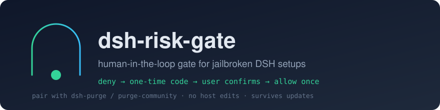

<p align="center"></p>

# dsh-risk-gate

[](https://github.com/oobitoooo/dsh-risk-gate/actions/workflows/ci.yml)
[](https://github.com/oobitoooo/dsh-risk-gate/releases)
[](LICENSE)
[](package.json)

**给「破甲」补一道人肉闸门。** 一个 DSH（DeepSeek Harness）插件，通常与 [`dsh-purge`](https://github.com/kingcharleslzy-ai/dsh-purge) / purge-community 一起用。

破甲把「逐步确认」拆掉了：审批自动放行、沙箱默认全开、拒绝话术中性化。后果是 `git push`、`Remove-Item -Recurse`、改注册表、装全局包、对外发数据这些动作**不再有人拦**。

本插件不撤销破甲——它只在**高危动作**上加一道机械闸：命中规则 → 宿主直接 `deny` → 模型必须把「确认 <编号>」原样转给你 → 你回复编号 → 同一条调用才放行（一次性、10 分钟过期）。

```
你：帮我把 dist 删了再打包
AI：[risk-gate] 已拦截：递归删除 / 格式化文件（R1）…
    「确认请回复：确认 8CFC6197」
你：确认 8CFC6197
AI：（原样重试，删除成功）
```

## 它解决的是什么问题

`dsh-purge` 的 patch #9 把 `@deepseek-ai/dsh-user-approval` 换成「每次请求直接 `allowed-once`」：

```js
// 宿主被打补丁后的实际行为
if (this.effectivePolicy(session) === "never") return "allowed-once";
return "allowed-once"; // 不再弹窗、不再 fail-closed
```

所以 **任何依赖 `kind: 'ask'` 的方案都等于自动同意**。把 approval 配置改回 `ask` 也没用——代码层被焊死了；让 purge 少打补丁也不行——它不支持按补丁禁用，升级还会重打。

本插件的做法是不走 approval：

1. 挂 `tools/pre-execute`（可重排的 allow/deny 门禁），命中就 `deny`；
2. 再挂 `ctx.tools.guard()` 做**单调兜底**——后续任何监听器想把 deny 翻成 allow，都会被它再挡一次；
3. 放行凭据 = **用户消息里出现的一次性编号**（从 `agent/pre-step` 读取，模型自己编的编号无效）；
4. 编号一次性、同一条命令重试复用同一个编号、10 分钟过期。

## 它不做什么

- 不修改宿主文件、不注入提示词人格、不碰 `app.asar`；
- 不撤销破甲的其它行为（连续执行、工具上限、子代理深度等照旧）；
- 不联网（除了你自己的 `policy.json`，没有任何外发）；
- 不是沙箱、不是权限系统。它拦的是**工具调用参数**，不是意图——见「边界」一节。

## 安装

需要 DSH Desktop 或 `dsh web`，Node ≥ 18（桌面端自带运行时即可）。

**方式一：GitHub 直装（推荐）**

```sh
dsh plugin --profile desktop add "https://github.com/oobitoooo/dsh-risk-gate/releases/latest/download/dsh-risk-gate-1.1.0.tgz"
# web profile 把 desktop 换成 web
```

> 想钉死版本：把 `latest/download/` 换成 `download/v1.1.0/`。

**方式二：本地 clone / link（开发用）**

```powershell
powershell -ExecutionPolicy Bypass -File scripts\install.ps1            # 默认 desktop profile
powershell -ExecutionPolicy Bypass -File scripts\install.ps1 -Profile web
```

装完**完全退出 DSH**（含托盘图标）再打开。之后改 `package.json` 内容或 profile 的 `cordis.patch.yml` 会触发热重载。

**方式三：手动**（不信任脚本时）

1. 把本仓库放到 `$DSH_HOME\plugins\dsh-risk-gate`；
2. profile 的 `package.json` 增加依赖 `"dsh-risk-gate": "file:../../plugins/dsh-risk-gate"`，并把 `"dsh-risk-gate"` 追加到 `dsh.profile.bundles`；
3. 在 profile 目录 `pnpm install`（或手工建 `node_modules\dsh-risk-gate` 的 junction 指回源码）；
4. 重启客户端。

## 确认流程

1. 我调用的工具命中规则 → 宿主返回：

   ```
   Error: [risk-gate] 已拦截：递归删除 / 格式化文件（R1）
   目标：Remove-Item -Recurse -Force "…\dist"

   这是高危操作，需要用户本人确认。请把下面这段原样发给用户，然后停下等回复：
   「…确认请回复：确认 8CFC6197」
   ```

2. 你回复 `确认 8CFC6197`；
3. 我原样重试同一条调用 → 放行一次；
4. 再执行同一条命令又会被拦（一次性）。

编号来源只有**用户消息**：你自己发的这条消息。模型自己写 `确认 8CFC6197` 不算，子代理/别的会话里确认也不通用。

### 批量任务：一次授权，跑完一整串

逐条确认在「发版 / 迁移 / 批量改名」这种连串动作里会变成反向升级。所以支持**授权窗口**：

```
你：授权 30 分钟
AI：（接下来 30 分钟内，高危操作直接放行，逐条写进 audit.jsonl，decision=allow-by-grant）
你：取消授权        ← 随时立即关闭
```

- 上限 120 分钟，超出的数字按 120 算；
- 窗口内仍然**逐条审计**（`audit.jsonl` 里 `allow-by-grant` + 剩余分钟），事后可查；
- 窗口内不改变任何规则判断，只是跳过「要编号」这一步；
- 只认**用户消息**里的这句，模型自己写不算。

## 默认拦什么

| 规则 | 内容 |
|---|---|
| R1 | 递归删除/格式化：`Remove-Item -Recurse`、`rm -rf`、`rmtree`、`diskpart`、`Format-Volume`。**例外**：目标在允许根内且条目数 ≤ `maxEntries`（默认 200）时直接放行；带 `;` `\|` `&&` 拼接不享受例外 |
| R2 | `git push`、`reset --hard`、`clean -f`、改远端、删 release/repo |
| R3 | 注册表、服务、计划任务、防火墙、执行策略、Defender 排除、hosts、takeown/icacls |
| R4 | 装/卸全局包与插件：`npm/pnpm -g`、`winget`、`choco`、`pip install`、`dsh plugin add` |
| R5 | 对外连接/外发：`ssh/scp/nc/chisel/frp/ngrok`、带 body 的 POST |
| R6 | 下载即执行/编码混淆：`\| iex`、`DownloadString`、`-EncodedCommand`、`FromBase64String` |
| R7 | 强杀进程/提权：`Stop-Process -Force`、`taskkill /f`、`runas`、`psexec`、`sudo` |
| R8 | `run_code` 里起子进程：`child_process`、`subprocess`、`os.system` |
| R9 | 删除或写关键路径：`C:\Windows`、`Program Files`、`ProgramData`、`resources\app`、`.ssh`、`.credentials` |

## 配置

运行时读 `$DSH_HOME/risk-gate/policy.json`（Windows：`%USERPROFILE%\.dsh\risk-gate\policy.json`），**改完热读，不用重启**。首次启动会自动落盘一份默认值。

```json
{
  "ttlMs": 600000,
  "rules": [
    { "id": "R1", "label": "递归删除 / 格式化文件", "flags": "i",
      "pattern": "remove-item[^\\n]*-recurse|\\brm\\s+-rf\\b|shutil\\.rmtree" }
  ],
  "protectedRoots": ["c:\\\\windows", "\\\\resources\\\\app", "\\\\.ssh"],
  "recursiveDelete": {
    "allowRoots": ["C:\\\\work\\\\my-project"],
    "maxEntries": 200,
    "useWorkdirAsRoot": false
  },
  "allow": ["^\\s*git\\s+(status|diff|log|show|branch)\\b"]
}
```

| 字段 | 作用 |
|---|---|
| `rules[]` | 命中任意一条即拦截（正则，`flags` 默认 `i`） |
| `protectedRoots[]` | `write`/`edit` 命中这些路径片段视为高危；删除类命令也用它做 R9 |
| `recursiveDelete.allowRoots` | R1 的例外根：只有落在这些目录下的小目录才免确认 |
| `recursiveDelete.maxEntries` | 条目上限，超了就重新要确认（数到上限+1 就停，不拖慢闸门） |
| `recursiveDelete.useWorkdirAsRoot` | 把工具调用的 `workdir` 也当作允许根（默认关，开了更省事但更宽松） |
| `allow[]` | 读类命令白名单，**只在命令没有链式拼接时生效** |
| `ttlMs` | 编号有效期，默认 10 分钟 |

其它产物：`risk-gate/audit.jsonl`（每次 block / allow-after-confirm，2 MB 轮转）、`risk-gate/boot.log`（启动阶段埋点）、`risk-gate/pending.json`、`risk-gate/last-user.json`。

## 与 dsh-purge 的关系

| 场景 | 结果 |
|---|---|
| DSH 桌面端升级 | 插件在 profile 里，一般不受影响；重启后跑一次 `scripts\verify.ps1` |
| dsh-purge 升级 / 重打补丁 | **不受影响**（本插件不在补丁目标列表里） |
| dsh-purge 卸载 / revert | 本插件照旧拦；被拆掉的是破甲的连续执行 |
| profile 被重置 | 会掉，重跑 `scripts\install.ps1` |
| 完全不用 dsh-purge | 也能用：此时宿主还有真正的 approval，本插件提供的是「按规则 + 编号」的另一套口径 |

已验证环境：DSH Desktop 0.2.1-rc.5 + dsh-purge-community 1.6.69（Windows 11 / Node 24）。

## 验证与开发

```sh
node --check lib/index.js      # 语法
node test/smoke.mjs            # 纯逻辑回归（假 ctx，不启动 DSH），33 条
node scripts/livecheck.mjs     # 用当前 policy.json 跑 20 条样例
node scripts/pack.mjs          # 生成 dsh-risk-gate-<version>.tgz（无需 npm）
```

Windows 上另有：

```powershell
powershell -ExecutionPolicy Bypass -File scripts\verify.ps1   # 四层接线体检
powershell -ExecutionPolicy Bypass -File scripts\status.ps1   # 策略/审计/待确认/自检
powershell -ExecutionPolicy Bypass -File scripts\uninstall.ps1
```

新会话里还可以直接问模型「跑一下 risk_gate status」——插件注册了 `risk_gate` 工具（`status / rules / pending / selftest / audit`）。

## 文档

| 文档 | 内容 |
|---|---|
| [docs/DESIGN.md](docs/DESIGN.md) | 为什么不走 approval、两条门（pre-execute + guard）、确认协议的设计取舍 |
| [docs/FAQ.md](docs/FAQ.md) | 「为什么我的命令被拦了」「编号能被伪造吗」「怎么彻底关掉」等高频问题 |
| [docs/COMPATIBILITY.md](docs/COMPATIBILITY.md) | 已验证宿主版本、依赖的宿主接口、与 purge 各补丁的对应关系 |
| [docs/PUBLISH.md](docs/PUBLISH.md) | 自己发一版：改版本、打包、建 Release、进市场 |
| [docs/FAQ.md#配置](docs/FAQ.md) · [examples/](examples/) | 严格档 / 宽松档两套现成策略 |
| [SECURITY.md](SECURITY.md) | 威胁模型、覆盖与不覆盖、报告方式 |
| [CONTRIBUTING.md](CONTRIBUTING.md) | 改规则的三条原则（只判操作数、不判提及…）、测试与发版流程 |

## 边界（请务必读）

- **拦的是调用参数，不是意图。** `python -c "print(1)"` 放行；用 python 调 `os.system` 会被 R8 拦。规则是正则，绕法无穷，真正的兜底是 `guard` 单调 + `audit.jsonl` 可追。
- **它不是沙箱。** 不隔离文件系统、不限制网络；它只决定「这一次工具调用要不要先问人」。
- **能关掉。** 卸载插件、删掉 bundle 条目、或者改 `policy.json` 把规则删空都行——它是护栏，不是锁。谁有本机写权限，谁就能拆。
- **误报优先于漏报。** 宁可多问你一次。误报改 `policy.json`，不用改代码。
- 编号只认**用户消息**；跨会话、子代理里的确认不通用。

## License

MIT。见 [LICENSE](LICENSE)。

本项目与 DeepSeek、dsh-purge 原作者均无隶属关系，是社区侧的独立补丁。
